# LumeBSD 1.5 "Farol"

[](https://github.com/Kalel047/lumebsd/actions/workflows/verificar.yml)
[](https://github.com/Kalel047/lumebsd/actions/workflows/build.yml)
[](LICENSE)

> Luz firme sobre fundação BSD.

LumeBSD é uma distribuição BSD independente construída a partir do código-fonte
do **FreeBSD 15.1** (`releng/15.1`). Ela mantém a base sólida do FreeBSD
(kernel, userland, rc.d, ZFS, ports/pkg) e dá ao sistema identidade,
ferramentas e padrões próprios.

A ideia: **um BSD de desktop que já chega pronto para quem fala português**.
Você grava o pendrive, testa o hardware sem tocar no disco, instala com
criptografia em poucos minutos e entra num KDE Plasma com visual próprio,
em pt-BR, com teclado ABNT2 e horário de Brasília.

O público: **estudantes e professores de exatas e de sociais aplicadas, e
quem só quer um computador que funcione**. Por isso o LumeBSD instala os
programas da sua área de uma vez, acha o substituto do programa que você
usava no Windows ou no Mac e abre um `.exe` com dois cliques.

```
     \    |    /
   ---  (( ))  ---
     /   _|_   \
        /___\
        |[_]|        LumeBSD 1.5
        |===|        "Farol"
        |   |
        |===|
       /|   |\
        |===|
       _|___|_
  ~~~~/_______\~~~~
   ~~   ~~~~   ~~
```

## Novidades

| | |
|---|---|
| **Papel e tinta de verdade** (1.5) | o filtro e-ink ganhou o **grão do papel** (fibras paradas na tela) e a **viscosidade da tinta**: quando a tela muda, o conteúdo novo assenta sobre o anterior, sem piscar |
| **Motor de renderização** (1.5) | o protótipo `lume-motor`: desenha direto na placa de vídeo (DRM/KMS), letras e desenhos calculados pelas equações das curvas em cada pixel, papel num compute shader, no modo de maior taxa do monitor ([docs/MOTOR.md](docs/MOTOR.md)) |
| **Papel noite** (1.5.1) | o tema escuro: fundo de tinta, letras de papel; `lume tema escuro` e `lume tema claro` trocam na hora; o filtro e-ink acompanha. E o disco instalado dá boot também em BIOS (máquinas virtuais do virt-manager e do GNOME Boxes) |
| **AMD e .iso** (1.5) | placas AMD (amdgpu e radeonkms) e processadores Ryzen; além do `.img`, uma **`.iso`** para DVD, máquina virtual ou pendrive |
| **Mac, começo** (1.5) | o `lume-macho` roda programas do macOS que falam direto com o kernel, traduzindo as chamadas do macOS para as do FreeBSD ([docs/MACOS.md](docs/MACOS.md)) |
| **A tela de papel** (1.4) | um filtro e-ink desenha as janelas em papel e tinta, que se lê melhor sob luz forte sem aumentar o brilho; fotos, vídeos e tela cheia ficam com cor; as janelas abrem com um **refresh de e-ink** ou esmaecendo |
| **Loja de cara nova** (1.4) | os Programas do LumeBSD com aparência própria de papel e tinta, como um livro: índice numerado, kits como capítulos |
| **Windows 32 bits e Mac** (1.4) | `.exe` de 32 bits abrem com o Wine (a parte de 32 bits vem na primeira vez, sem senha); um `.dmg` do Mac mostra o que usar no lugar |
| **Programas do LumeBSD** (1.3) | a loja em português: mais de 100 programas escolhidos, **kits por área** (Uso geral, Exatas e engenharia, Sociais aplicadas) e uma busca que acha pelo programa que você usava (“matlab” mostra o Octave, “spss” o R com RKWard) |
| **Windows, Linux e web** (1.3) | dois cliques num `.exe` oferecem o Wine e abrem o programa; Microsoft 365, Teams, Overleaf, WhatsApp e outros como apps no menu; a camada Linux liga sozinha |
| **Ajuda do LumeBSD** (1.3) | um guia em português no menu (`lume ajuda`): o que usar no lugar de cada programa, Wi-Fi e hardware, e o que fazer quando algo dá errado |
| **Atualizações do LumeBSD** (1.2) | um app no menu que avisa quando sai versão nova, mostra as novidades e instala com um botão; correções, versões novas e versões principais (inclusive trocando o FreeBSD por baixo) pelo mesmo caminho, sempre com volta automática |
| **Máquina do tempo** (1.1.2) | `lume tempo` tira uma foto do disco por hora (snapshots do ZFS) e guarda por dias e semanas; traz de volta um arquivo apagado, a versão de ontem de um documento ou o sistema inteiro de antes de uma instalação. No Dolphin: botão direito, **Versões anteriores** |
| **Atualizações que não quebram** (1.1.1) | `lume atualizar` instala a versão nova num ambiente de boot à parte, testa no boot seguinte e só então a torna padrão; se algo der errado, o computador volta sozinho para o sistema anterior |
| **Pendrive ao vivo + instalador** | boota sem tocar no disco; `lume hardware` diz o que funciona; `lume instalar` instala no disco inteiro |
| **PCs Intel + NVIDIA** | o driver NVIDIA certo para a geração da placa (Turing/GTX 16xx em diante, 580 para Maxwell–Volta, 470 para Kepler), Intel em notebooks e híbridos, e volta sozinho ao modo sem aceleração se um driver travar |
| **ZFS criptografado** | GELI AES-256-XTS com senha no boot, swap criptografada, ambientes de boot (`bectl`) |
| **forja** | gerenciador de pacotes no estilo Portage: binário por padrão, compilado com as suas opções (as "USE flags") quando você muda alguma |
| **Tema Papel** | KDE Plasma com estética e-ink: papel, tinta e cinzas |
| **Base** | FreeBSD 15.1, kernel `LUME` completo (todos os módulos, DTrace), compilado com LLVM 19 |

## Do pendrive ao desktop

### 1. Gravar

Baixe `LumeBSD-1.5-Farol-pendrive.img.xz` (ou a `LumeBSD-1.5-Farol.iso`) das
[Releases](https://github.com/Kalel047/lumebsd/releases) (ou do último
[Build completo](https://github.com/Kalel047/lumebsd/actions/workflows/build.yml),
em "Artifacts"), confira o SHA256 com o `SHA256SUMS` que vem junto, extraia
(7-Zip no Windows) e grave num pendrive de 8 GB ou mais:

- **Windows**: [Rufus](https://rufus.ie), escolha a imagem e, quando ele
  perguntar, **modo DD**.
- **Linux/FreeBSD**: `dd if=LumeBSD-1.5-Farol-pendrive.img of=/dev/SEU_PENDRIVE bs=1M`

A `.iso` serve para gravar num DVD, abrir numa máquina virtual (VirtualBox,
VMware, QEMU, GNOME Boxes) ou num pendrive com o Ventoy; também pode ser
gravada direto num pendrive como a `.img` (o Rufus pergunta: escolha o modo
DD). No sistema ao vivo da `.iso`, o disco é só de leitura e o que muda fica
na memória.

Na BIOS/UEFI do PC, desligue o *Secure Boot* (o loader do FreeBSD não é
assinado) e dê boot pelo pendrive (F12 na maioria das placas).

### 2. Testar o hardware

O pendrive é um LumeBSD completo. Entra como root, sem senha, e nada no
disco do computador é alterado.

```
root@lume-ao-vivo:~ # lume hardware        (numa VM; no seu PC aparece a sua placa)

  LumeBSD - diagnóstico de hardware
  QEMU pc-q35-8.2 (Standard PC (Q35 + ICH9, 2009))
  ------------------------------------------------------------
  ✓ processador    QEMU Virtual CPU version 2.5+ (2 núcleos)
  ! energia CPU    sem controle de frequência
  ✓ memória       4 GiB
  ✓ disco nda0     QEMU NVMe Ctrl 42 GB
  ! vídeo         sem placa NVIDIA ou Intel: modo sem aceleração
  ! Wi-Fi          nenhuma placa encontrada
  ✓ rede em0       cabo active
  ✗ som            nenhuma placa de som reconhecida
  ------------------------------------------------------------
  4 ok, 3 atenção, 1 não funciona
```

`lume video testar` carrega o driver de vídeo na hora, para você ver se
ele funciona antes de instalar. `lume wifi` conecta no Wi-Fi.

### 3. Instalar

```
root@lume-ao-vivo:~ # lume instalar
```

Ele pergunta o disco, pede para você digitar `APAGAR`, pede a senha do
disco e instala:

- GPT com partição EFI, swap de 8 GB criptografada e o resto em ZFS sobre
  GELI (AES-256-XTS); a senha é pedida pelo loader, antes do sistema;
- datasets do ZFS no esquema de ambientes de boot (`zroot/ROOT/default`),
  então `bectl` e as atualizações da forja têm volta;
- boot UEFI registrado com `efibootmgr` e no caminho padrão `BOOTX64.EFI`,
  e o boot para BIOS (`gptzfsboot`): o disco liga nos dois tipos de firmware;
- os drivers e firmwares que vêm no pendrive;
- com internet, o desktop (KDE Plasma 6, Firefox, Konsole, Dolphin, Kate,
  Okular, PipeWire...) já com o driver de vídeo certo e o tema Papel;
- e o **kit da sua área**, se você escolher um:

```
  Para que você vai usar o computador? Os programas da área vêm junto.
    1) Uso geral: escritório em português, vídeo, apps da web (~400 MB)
    2) Exatas e engenharia: Octave (como o MATLAB), Python, GeoGebra (~850 MB)
    3) Sociais aplicadas: R, estatística, Zotero (~1,2 GB)
    4) Só o desktop; escolho depois no app Programas do LumeBSD
```

> Reinstalando num PC que já tem o LumeBSD? O loader do pendrive vê o
> disco criptografado e pergunta a senha dele: aperte Enter para pular.

### 4. Primeiro boot

Depois da senha do disco, o assistente em português pergunta o essencial:

```
  [1/6] Senha do administrador (root)
  [2/6] Seu usuário              -> grupos wheel, operator e video
  [3/6] Nome desta máquina
  [4/6] Fuso horário             -> padrão America/Sao_Paulo
  [5/6] Teclado                  -> ABNT2, US internacional, US ou Portugal
  [6/6] Idioma do sistema        -> Português (Brasil) ou English (US)
```

e o sistema sobe direto na tela de login gráfica.

## Programas do LumeBSD

Quem chega do Windows ou do Mac procura o programa que já conhece. No app
**Programas do LumeBSD** (menu **Sistema**), a busca acha por ele:
“matlab” mostra o GNU Octave, “spss” o R com RKWard, “autocad” o LibreCAD
e o FreeCAD. São mais de 100 programas escolhidos, em português, por
categoria, e três **kits por área**, que o instalador também oferece:

| Kit | O que vem |
|---|---|
| **Uso geral** | LibreOffice em português, as fontes do Office, Xournal++, VLC e os apps da web (Microsoft 365, Teams, Google Drive, WhatsApp) |
| **Exatas e engenharia** | o Uso geral, mais GNU Octave, Python científico com JupyterLab, wxMaxima, GeoGebra, LabPlot, Qalculate!, Desmos e Overleaf |
| **Sociais aplicadas** | o Uso geral, mais R com RKWard, Python para dados, Zotero e Power BI |

Instalar pede a senha e mostra o progresso; remover tira só o que nenhum
outro programa usa. Os apps da web (Office 365, Teams, Outlook, Meet,
Zoom, Overleaf, Power BI...) viram atalhos no menu, sem senha. E **dois
cliques num `.exe`** oferecem o Wine, instalam e abrem o programa; um
`.exe` de 32 bits ganha uma explicação (o FreeBSD 15 não traz mais a parte
de 32 bits que o Wine usa para eles). A **Ajuda do LumeBSD** (`lume
ajuda`) explica tudo isso em português, com uma tabela do que usar no
lugar de cada programa.

```
lume loja                    # os kits
lume loja procurar matlab    # pelo programa que você usava
lume loja kit exatas         # um kit inteiro (como root)
lume compat                  # Windows (Wine) e Linux
```

| | |
|---|---|
| 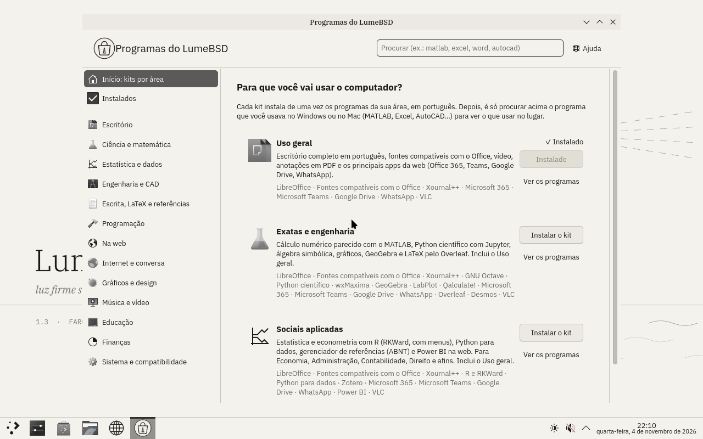 | 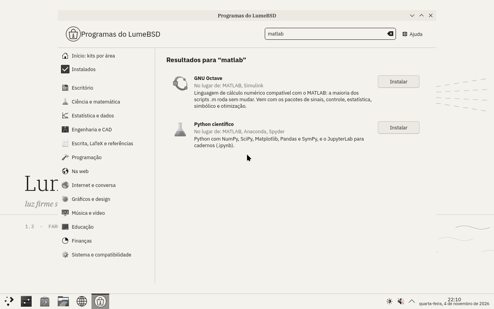 |
| 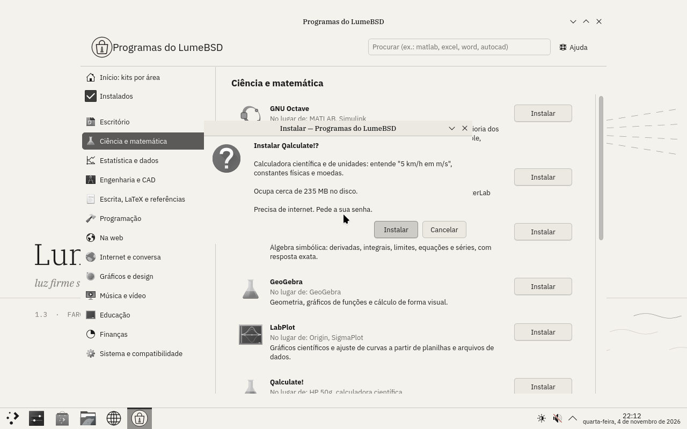 | 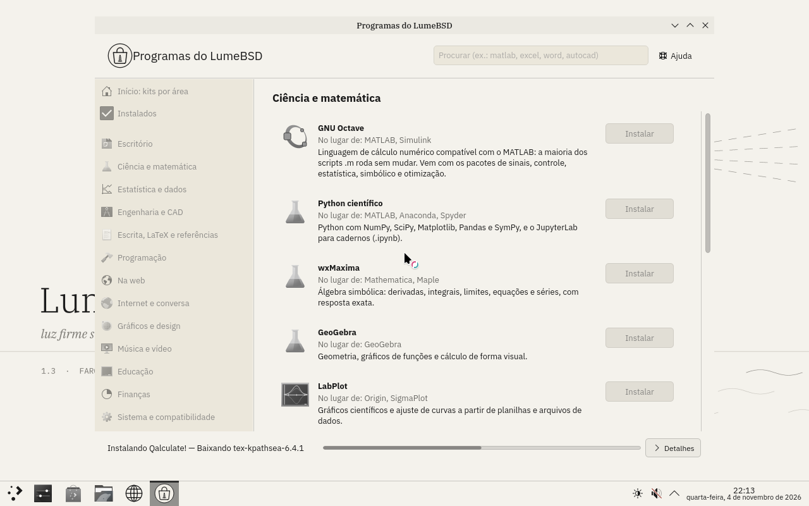 |
| 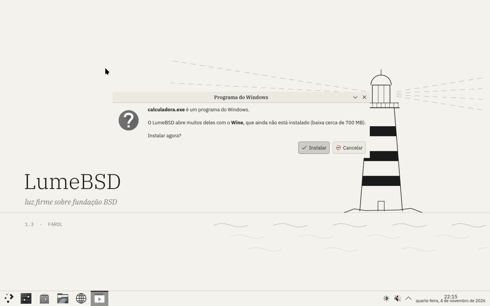 | 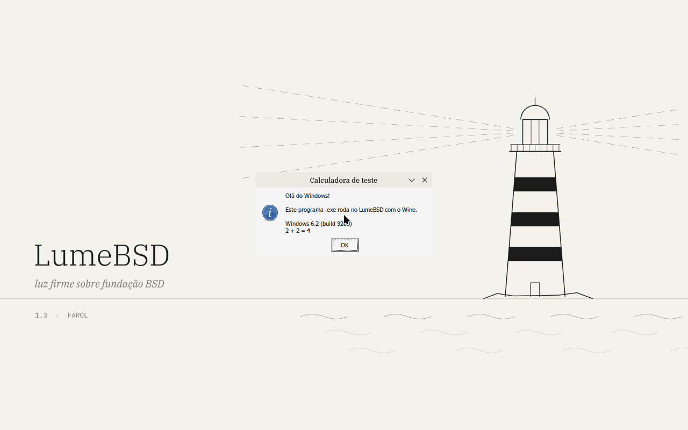 |
| 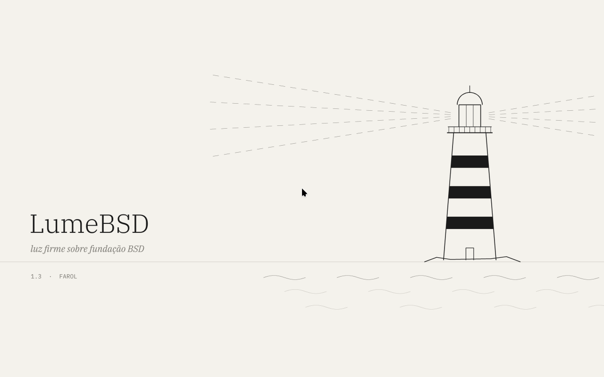 | 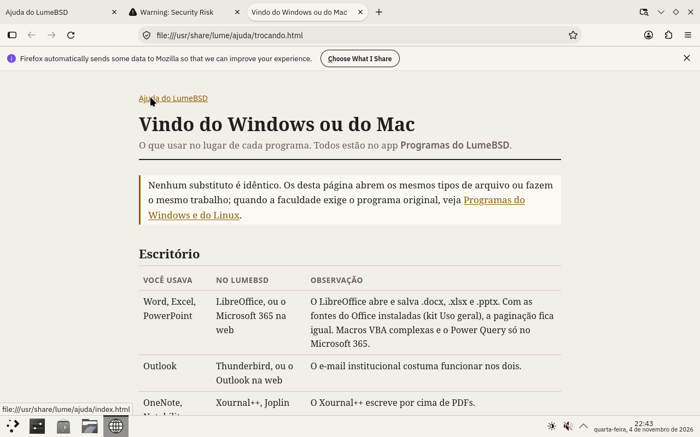 |

## Atualizações que não quebram

O LumeBSD se atualiza pelo app **Atualizações do LumeBSD** (menu
**Sistema**), sem comando nenhum:

- quando sai uma versão nova, um aviso aparece na bandeja;
- o app mostra o que é (correção, versão nova ou versão principal), o
  tamanho e as novidades; **Instalar** pede a sua senha e mostra o
  progresso; no fim, **Reiniciar agora**;
- se o boot da versão nova der errado, o computador volta sozinho, e o app
  explica o que aconteceu e oferece apagar a tentativa;
- **Voltar para a versão anterior** desfaz a última atualização, sem
  mexer nas suas pastas.

| | |
|---|---|
| 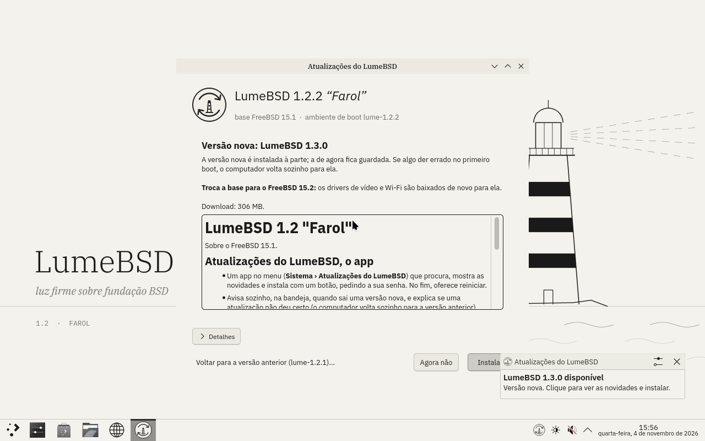 | 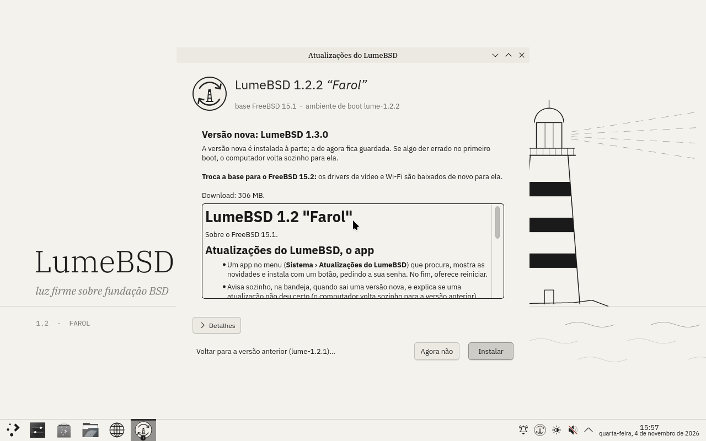 |
| 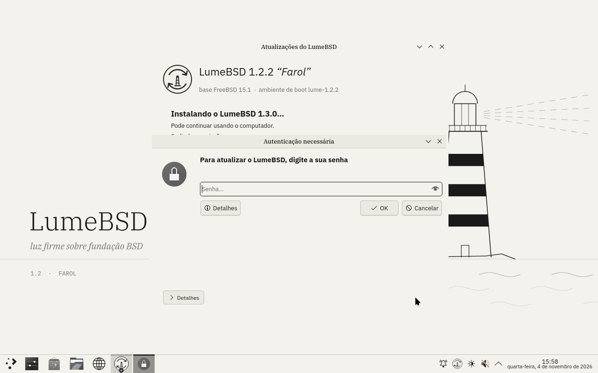 | 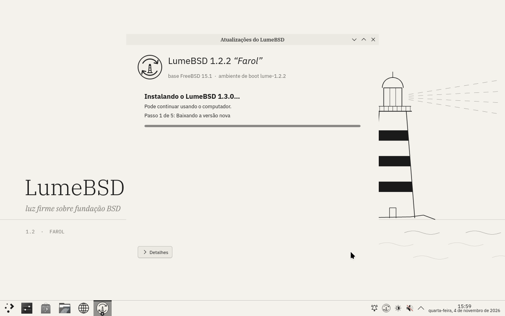 |
| 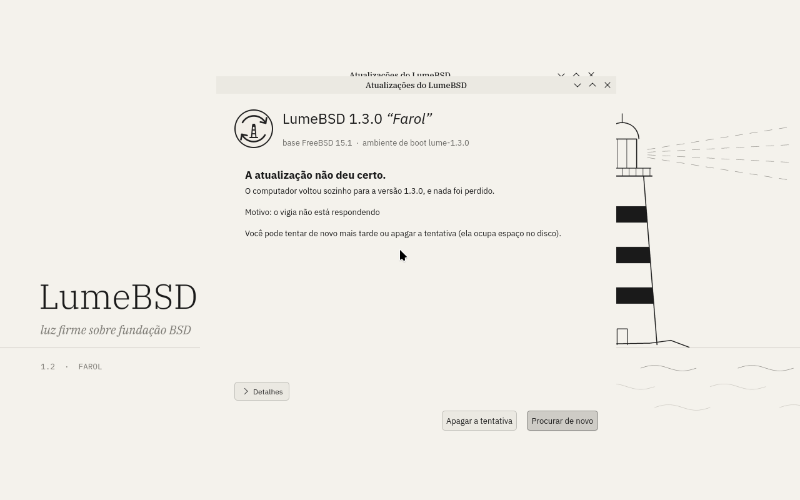 | 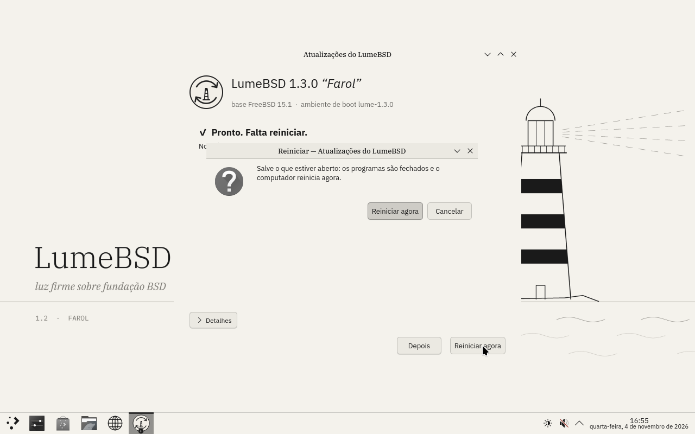 |

<sub>O app no sistema instalado numa VM: o aviso, uma versão nova com troca
de base FreeBSD (simulada), a senha, a instalação, a tela depois de uma
atualização quebrada de propósito e o reiniciar.</sub>

Por trás, o mesmo `lume atualizar` do terminal:

1. a versão nova vai para um **ambiente de boot novo** (uma cópia do
   sistema no ZFS); o sistema em uso não é tocado;
2. ele é ativado **só para o próximo boot** (`bectl activate -t`);
3. no fim desse boot, o `rc.d/lume_saude` confere o sistema: a raiz veio
   do ambiente certo, os programas básicos existem, o vigia responde, a
   tela de login subiu. Passou: a atualização vira o **padrão**;
4. não passou, o kernel entrou em pânico ou o computador travou: o boot
   seguinte volta **sozinho** para o sistema anterior, intacto. O motivo
   fica em `/var/log/lume-atualizar.log`.

No FreeBSD, o `freebsd-update` troca os arquivos do sistema em uso; se a
atualização der errado no meio, ou o sistema novo não subir, quem conserta
é você.

### Correção, versão nova, versão principal

Qualquer versão mais nova serve. O que muda o trabalho é o FreeBSD por
baixo, que o índice da versão informa:

| Versão nova | Exemplo | O que acontece |
|---|---|---|
| mesma base FreeBSD | 1.2.0 → 1.2.1, 1.2 → 1.3 | só o sistema troca |
| base nova da mesma série | FreeBSD 15.1 → 15.2 | os drivers de vídeo, Wi-Fi e firmwares são baixados de novo para o kernel novo |
| série nova | FreeBSD 15 → 16 (LumeBSD 2) | todos os programas são baixados de novo |

Os pacotes são baixados antes, ainda no sistema em uso, e instalados no
primeiro boot da versão nova, já com o kernel novo (`rc.d/lume_pacotes`).
Se falharem, a atualização não é confirmada e o computador volta. Quem tem
uma versão muito antiga para pular direto é levado antes à intermediária
(`minimo=` no índice).

Suas configurações ficam como estão; uma que você nunca mexeu é trocada
pela nova, e quando você mexeu, a nova aparece ao lado, com o final
`.lume-novo`. Usuários e senhas nunca são tocados. No terminal: `lume
atualizar` (procura, pergunta, instala), `estado`, `voltar`, `descartar`,
`confirmar` e `limpar`.

As versões saem nas [Releases](https://github.com/Kalel047/lumebsd/releases):
o índice `atualizacao.txt` diz a versão, a base FreeBSD, o SHA256 do
pacote e as novidades.

> Quem tem uma versão anterior à 1.2 atualiza uma vez pelo terminal (as
> regras novas vêm na própria atualização):
> `fetch -o /tmp/lume-atualizar https://raw.githubusercontent.com/Kalel047/lumebsd/main/fonte/usr.sbin/lume-configurar/lume-atualizar.sh && sh /tmp/lume-atualizar aplicar`

## Máquina do tempo

O FreeBSD tem ZFS e snapshots, mas nada que os tire sozinho nem um jeito
simples de voltar no tempo. O LumeBSD vem com isso ligado:

```
kalel@farol:~ $ lume tempo versoes Documentos/contrato.odt

  /home/kalel/Documentos/contrato.odt
  hoje 14:00                  48 KB   lume-2026-11-04_14.00.02
  hoje 10:00                  41 KB   lume-2026-11-04_10.00.01
  ontem 18:00                 37 KB   lume-2026-11-03_18.00.03

kalel@farol:~ $ lume tempo recuperar Documentos/contrato.odt ontem
  ✓ versão de ontem 18:00 recuperada em:
    /home/kalel/Documentos/contrato (de 03-11 18.00).odt
```

- **Uma foto por hora**, só quando algo mudou, das pastas pessoais e do
  sistema. As fotos são instantâneas e só ocupam o que mudou depois delas.
- **Guardadas por um tempo que faz sentido**: todas das últimas 24 horas,
  uma por dia por 30 dias, uma por semana por 6 meses. Com o disco acima
  de 85%, as automáticas mais velhas saem primeiro.
- **Antes de cada mudança**: `forja instalar/remover/atualizar` e `lume
  atualizar` tiram uma foto antes de mexer.
- **Um arquivo** (`versoes`, `recuperar`): sem ser root, inclusive
  arquivos apagados; a versão antiga vai **ao lado** da atual, com a data
  no nome, ou no lugar dela (`--substituir`, e a atual fica guardada).
- **O sistema inteiro** (`lume tempo voltar 3`): um ambiente de boot com
  o sistema como estava naquela foto; as pastas pessoais não mudam, e o
  sistema de agora fica guardado para desfazer.
- `lume tempo mudou 2`: o que foi criado, apagado ou mudado desde a foto.
- No **Dolphin**, botão direito num arquivo ou pasta, **Versões
  anteriores**: escolha a versão e abra, recupere ao lado ou substitua.

`lume tempo foto "antes de mexer no projeto"` tira uma foto que fica até
você apagar. Tudo em `man lume-tempo`.

| | |
|---|---|
| 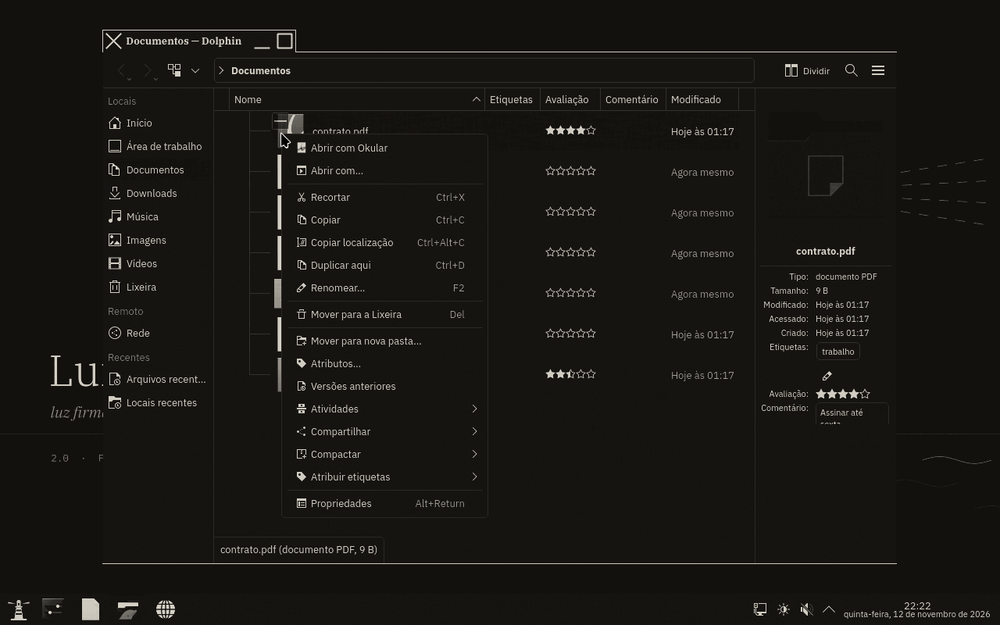 | 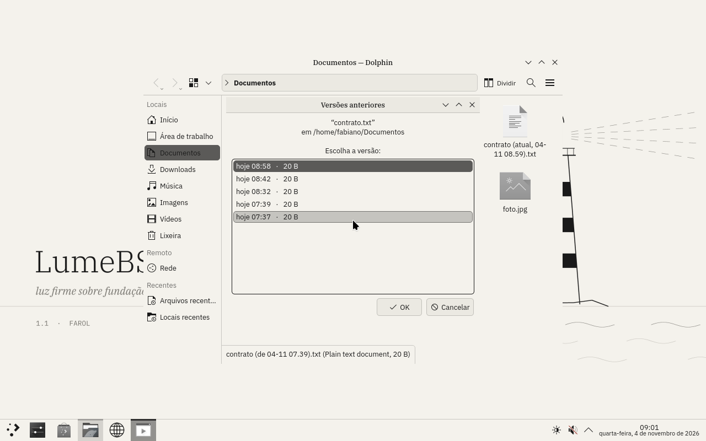 |
| 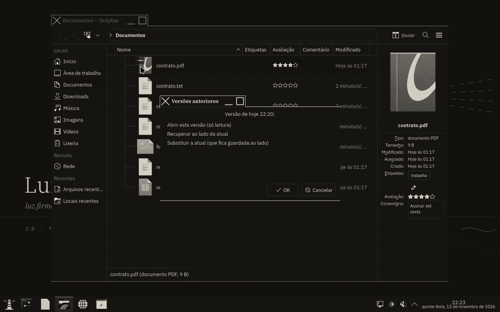 | 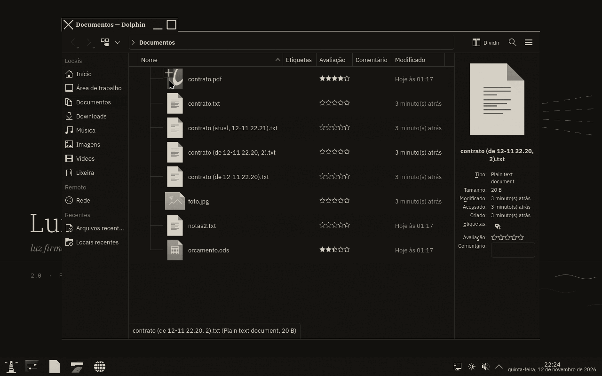 |

<sub>"Versões anteriores" no Dolphin, no sistema instalado numa VM.</sub>

## Vídeo: Intel + NVIDIA

`lume video` decide a cada boot (`rc.d/lume_video`):

| Computador | Driver |
|---|---|
| Desktop com NVIDIA Turing em diante (GTX 16xx, RTX) | `nvidia-driver` (595) |
| NVIDIA Maxwell, Pascal ou Volta (GTX 9xx/10xx) | `nvidia-driver-580` |
| NVIDIA Kepler (GTX 6xx/7xx) | `nvidia-driver-470` |
| Intel (inclusive notebook híbrido Intel + NVIDIA) | `drm-612-kmod` (i915/xe) |
| Nada disso, ou um driver que falhou | `scfb` (framebuffer UEFI, sem aceleração) |

Se o driver travar o computador no boot, o boot seguinte percebe (marca em
`/var/db/lume/video-tentando`) e passa para o `scfb` sozinho. Dá para fixar
um modo: `lume video nvidia | intel | scfb | auto`.

> Num notebook híbrido, a tela interna está ligada na Intel; a NVIDIA
> fica sem uso (o FreeBSD não tem PRIME offload maduro).

## forja: pacotes no estilo Portage

```
forja instalar htop                 # binário oficial, instala em segundos
forja opcoes nano -NLS -DOCS        # muda opções (as "USE flags")
forja instalar nano                 # agora compila da árvore de ports com elas
forja atualizar                     # foto do disco, binários e recompilações
forja mundo                         # o que você pediu (o @world)
```

- Cada pacote vem **binário** até você mudar uma opção dele; aí a forja o
  compila da árvore de ports com as suas opções e o **trava** (`pkg lock`)
  para a atualização binária não desfazer a escolha.
- `forja instalar`, `remover` e `atualizar` tiram uma foto do disco antes
  de mexer em qualquer coisa (`lume tempo`; se algo quebrar, `lume tempo
  voltar 1`); `atualizar` atualiza os binários e recompila só o que mudou
  de versão ou de opções.
- `forja arvore` baixa a árvore de ports do trimestre (`2026Q4`).
- Arquivos: `/etc/forja/forja.conf`, `/etc/forja/opcoes`,
  `/var/db/forja/mundo`. Manual: `man forja`.

## Tema Papel (e-ink)

O desktop vem com um visual próprio inspirado nas telas de e-ink
(Kindle, reMarkable, Boox) e nos setups monocromáticos do r/unixporn:

- **cores**: papel `#F4F2EC`, tinta `#1A1A1A` e cinzas quentes; o único
  acento é um vermelho escuro para erros; seleção invertida (tinta sobre
  papel, como num e-reader);
- **fontes**: IBM Plex Sans, Serif (títulos das janelas) e Mono (terminal);
- **filtro e-ink** (1.4): um efeito do KWin desenha cada janela em papel e
  tinta; fotos, vídeos, editores de imagem e janelas em tela cheia ficam
  com cor (Ctrl+Meta+T liga e desliga, `lume tema tinta`); na 1.5, o grão
  do papel e a viscosidade da tinta (`lume tema tinta grao`,
  `lume tema tinta viscosidade`);
- **sem sombras, transparência nem animações de deslizar e crescer**
  (`AnimationDurationFactor=0`): as janelas abrem com o **refresh de
  e-ink**, escuras por um instante e o conteúdo de uma vez, ou esmaecendo
  em cinza (`lume tema animacao`);
- **ícones em tons de cinza**: o tema `lume-papel` é gerado a partir do
  Breeze, convertendo cada cor para luminância;
- **papel de parede**: o farol em traço sobre papel (`papel.png`) e uma
  versão noturna (`papel-noite.png`), em 4K;
- **Papel noite** (1.5.1): o mesmo tema no escuro, com fundo de tinta e
  letras de papel; cores do KDE e do Konsole, ícones Breeze Dark em cinza,
  GTK, os apps do LumeBSD e o filtro e-ink acompanham. `lume tema escuro` e
  `lume tema claro` trocam na hora para quem roda; `lume tema papel noite`
  (root) faz do escuro o padrão. Os arquivos são gerados do Papel por
  `ferramentas/tema-noite.py`;
- Konsole, SDDM (tela de login), tela de bloqueio, GTK e splash seguem o
  mesmo tema.

`lume tema padrao` volta ao visual original do KDE; `lume tema papel`
aplica de novo.

| | |
|---|---|
|  |  |
|  |  |

<sub>Capturas reais do sistema instalado numa VM (sem aceleração de vídeo).</sub>

## Ferramentas do LumeBSD

| Comando | O que faz |
|---|---|
| `lume` | painel: kernel, CPU, memória, disco, carga, serviços, versão e a última foto do disco |
| `lume hardware` | o que funciona neste computador |
| `lume video [testar\|auto\|nvidia\|intel\|scfb]` | driver de vídeo |
| `lume wifi` | conecta no Wi-Fi |
| `lume desktop` | instala o KDE Plasma e os drivers |
| `lume instalar` | instala no disco inteiro (ZFS + GELI) |
| `lume atualizar` | atualiza o sistema num ambiente de boot, com volta automática (o app **Atualizações do LumeBSD** faz o mesmo no desktop) |
| `lume tempo` | máquina do tempo: fotos do disco, versões de arquivos, o sistema de antes |
| `lume loja` | programas por área e kits (o app **Programas do LumeBSD** faz o mesmo no desktop) |
| `lume compat` | programas do Windows (Wine) e do Linux |
| `lume ajuda` | a Ajuda do LumeBSD, no navegador |
| `lume tema [papel\|escuro\|claro\|padrao]` | visual do KDE (claro ou o Papel noite) |
| `lume configurar` | assistente de configuração |
| `vigia` | gerenciador de serviços (abaixo) |
| `forja` | pacotes por binário ou código-fonte |

### vigia: serviços que se reerguem sozinhos

Cada serviço é um arquivo de poucas linhas em `/etc/vigia/servicos`:

```ini
descricao = Página "Olá" na porta 8080
comando   = sh -c 'while true; do printf "HTTP/1.0 200 OK\r\n\r\nOlá\n" | nc -N -l 8080; done'
usuario   = nobody
depende   = relogio
reiniciar = sempre
limite_memoria = 64M
limite_cpu     = 50%
```

O `vigiad` sobe os serviços na ordem das dependências, reinicia o que cair
(1, 2, 4… até 30 s), põe em **manutenção** depois de 5 quedas seguidas,
guarda a saída em `/var/log/vigia/`, limita memória, CPU e processos pelo
RCTL do kernel, atende sockets sob demanda (`escutar = tcp:7777`, como o
`inetd`) e para em cascata quem depende de um serviço parado.

```
root@lumebox:~ # vigia
  SERVIÇO       ESTADO         PID     HÁ         REINÍCIOS  DESCRIÇÃO
  instavel      ● manutenção   -       11 s       4          Serviço instável (demonstração)
    └ saiu com código 3; caiu 5 vezes seguidas, veja 'vigia log instavel' e use 'vigia reiniciar instavel'
  ntpd          ● ativo        1114    53 s       0          Relógio sincronizado pela internet (NTP)
  web           ● ativo        1224    39 s       1          Página "Olá" na porta 8080
```

Manuais: `man vigia` e `man vigia.conf`. Sessões reais em
[docs/vigia-sessao.log](docs/vigia-sessao.log) e
[docs/vigia-recursos-sessao.log](docs/vigia-recursos-sessao.log).

## Estrutura

```
patches/               a fonte de verdade: o que muda no FreeBSD, em ordem
  0001..0004           identidade, assistente, vigia (da 1.0)
  0005                 base FreeBSD 15.1, kernel LUME completo
  0006                 pendrive: lume hardware, video, wifi, desktop, instalar
  0007..0009           pkg trimestral, espelho local, kernel com CTF
  0010                 vídeo Intel + NVIDIA por geração
  0011                 forja
  0012                 tema Papel
  0013..0024           correções que os testes pegaram; lume atualizar (1.1.1)
  0025                 lume tempo, a máquina do tempo (1.1.2)
  0026..0027           lume atualizar pela base FreeBSD, lume_pacotes; 1.2
  0028..0030           lume loja, lume compat, lume ajuda; 1.3
  0031..0034           a tela de papel, Windows 32 bits, Mac, atalhos
                       do KWin; 1.4
  0035..0041           AMD, a .iso, papel e tinta, lume-macho; 1.5
app/                   os apps Atualizações e Programas do LumeBSD (Qt 6), os
                       efeitos do KWin (o filtro e-ink e as animações) e o
                       lume-motor, fora da árvore do FreeBSD;
                       ferramentas/montar-*.py os compilam
mac/                   lume-macho (programas do macOS) e o programa de teste
fonte/                 os mesmos arquivos em texto puro, para ler e navegar
                       (forja, lume, vigia, lume-configurar, rc.d, tema...)
conf/                  src.conf (userland) e LUME (kernel)
build-lumebsd.sh       do FreeBSD fixado até a imagem do pendrive
ferramentas/           pacotes.py, montar-pendrive.py, fonte.py,
                       papel-de-parede.py, conferir-catalogo.py (a loja)
tests/                 testes no QEMU pelo console serial
docs/ARQUITETURA.md    como tudo funciona por dentro
docs/                  sessões reais e capturas de tela
.github/               CI (Verificar e Build completo) e modelos de issue
```

Para mudar o código: edite a árvore do FreeBSD com os patches aplicados,
faça commit, gere os patches de novo
(`git format-patch -N --no-signature <commit fixado>..HEAD -o patches/`) e rode
`python3 ferramentas/fonte.py gerar src`. O CI recusa `fonte/` diferente dos
patches.

## Construindo

Funciona em Linux (cross-build com LLVM 19) ou FreeBSD:

```sh
git clone https://github.com/Kalel047/lumebsd.git
cd lumebsd
sh build-lumebsd.sh
```

O script clona o FreeBSD `releng/15.1`, aplica os patches, compila
userland e kernel `LUME`, instala num diretório de staging sem precisar de
root, baixa os pacotes essenciais do repositório trimestral do FreeBSD
(conferindo os hashes), compila os apps contra o `qt6-base`
do FreeBSD e gera `LumeBSD-1.5-Farol-pendrive.img`, a `LumeBSD-1.5-Farol.iso` e, em `atualizacao/`, o
pacote de atualização com o índice e as novidades (`docs/novidades.md`).
Leva várias horas numa máquina de 2 núcleos (o world é a parte longa).

Dependências no Ubuntu/Debian:

```sh
sudo apt install clang-19 lld-19 llvm-19 libarchive-dev libbz2-dev zlib1g-dev \
    bison flex time python3 qemu-system-x86 ovmf
```

> Precisa ser o **LLVM 19** (o mesmo do FreeBSD 15.1). O clang 18 do
> Ubuntu acessa `__stack_chk_guard` pela GOT nos módulos do kernel, e o
> linker do kernel recusa essa relocação: metade dos módulos (inclusive
> `zfs.ko` e `geom_eli.ko`) não carregaria.

## Testando

O teste automatizado faz o caminho de um usuário no QEMU (UEFI, disco
NVMe de destino), conversando pelo console serial:

```sh
python3 -m http.server 8000 -d ESPELHO &   # espelho dos pacotes (opcional)
python3 tests/teste-pendrive.py aovivo    aovivo.log     # boot, lume hardware, instala
python3 tests/teste-pendrive.py instalado instalado.log  # senha do disco, assistente
python3 tests/teste-pendrive.py desktop   desktop.log    # login gráfico, fotos da tela
python3 tests/teste-pendrive.py forja     forja.log      # binário, compilação, atualizar
python3 tests/teste-pendrive.py tempo     tempo.log      # lume tempo e "Versões anteriores"
python3 tests/teste-pendrive.py app       app.log        # o app: aviso, senha, instalar, reiniciar
python3 tests/teste-pendrive.py app-falhou falhou.log    # depois de uma atualização reprovada
python3 tests/teste-pendrive.py app-voltar voltar.log    # voltar para a versão anterior
LUME_TESTE_KIT=geral python3 tests/teste-pendrive.py aovivo aovivo.log  # instala com um kit
python3 tests/teste-pendrive.py loja      loja.log       # loja, senha, um .exe no Wine, Ajuda
python3 tests/teste-pendrive.py eink      eink.log       # filtro e-ink, loja nova, .exe 32 bits, .dmg
```

## Status

Tudo abaixo foi testado de ponta a ponta no QEMU (UEFI/OVMF, sem KVM),
com um disco NVMe de 40 GB como destino e o pendrive ligado em SATA:

- [x] **Build do zero**: FreeBSD 15.1 + 32 patches, world com LLVM, kernel
  `LUME` completo (847 módulos) com LLVM 19 — também no GitHub Actions
  (2h12 de build, imagem bootada no QEMU), a partir deste repositório
- [x] **Pendrive ao vivo**: boot até o login em ~1 min (emulado), `lume
  hardware`, `lume video`, drivers do pendrive carregando
- [x] **Instalação**: GPT + EFI + swap GELI + ZFS sobre GELI AES-256-XTS,
  ambientes de boot, entrada UEFI "LumeBSD"; desktop KDE (692 pacotes)
  instalado a partir de um espelho, tema Papel aplicado, 7 847 ícones
  convertidos — ~49 min emulado
- [x] **Primeiro boot**: senha do disco pedida uma vez pelo loader,
  assistente completo (root, usuário nos grupos wheel/operator/video,
  máquina, fuso, ABNT2, pt-BR), SDDM no ar
- [x] **Desktop**: login gráfico em português, Plasma 6.7 com o tema Papel,
  Konsole e Dolphin abertos na sessão (capturas em `docs/capturas/`)
- [x] **forja**: binário (`htop`), opções `-NLS -DOCS`, compilação do
  `nano` da árvore de ports com as dependências diretas em binário
  (`nano --version` → `--disable-nls`), `forja mundo`/`info`, `forja
  atualizar` com ambiente de boot antes e recompilação ao mudar opção
- [x] **Atualização**: 1.1.0 → 1.1.1 num sistema instalado pela 1.1.0,
  confirmada sozinha no boot; uma 1.1.2 com o `vigiad` quebrado (checagem
  reprovada, motivo no log, reboot de volta à 1.1.1); uma 1.1.2 com o
  `init` quebrado (pânico, reboot automático, de volta à 1.1.1); boot
  interrompido no meio (de volta ao anterior)
- [x] **Ambientes de boot**: numa instalação nova, bootar outro ambiente
  roda de fato aquele ambiente
- [x] **Atualizações (1.2)**: 1.1.2 → 1.2.0 (versão nova, pelo comando de
  uma vez); 1.2.0 → 1.2.1 (correção); 1.2.1 → 1.2.2 **pelo app**: aviso na
  bandeja, novidades, senha no polkit, progresso, pronto; 1.2.2 → 1.3.0
  trocando a base FreeBSD 15.1 → 15.2 (simulada: os 16 pacotes de drivers
  baixados antes e instalados no boot pelo `lume_pacotes`, sem internet,
  depois confirmada); uma 1.3.1 quebrada de propósito (reprovada, de volta
  à 1.3.0, o app explica e apaga a tentativa); voltar para a versão
  anterior e reiniciar pelo app; versão intermediária (`minimo=`); o app
  compilado no CI. A troca de série (FreeBSD 15 → 16) só tem o aviso e o
  caminho comum testados: ainda não existem pacotes do FreeBSD 16
- [x] **Máquina do tempo**: 1.1.1 → 1.1.2 pelo `lume atualizar` (fotos
  ligadas sozinhas, foto automática pelo `cron`); como usuário comum,
  versões de um arquivo, arquivo apagado de volta, versão antiga ao lado e
  no lugar; `mudou` com nomes acentuados; limpeza pela idade; `lume tempo
  voltar` para antes de uma instalação (o sistema volta, `/home` fica) e o
  desfazer; foto antes do `forja` e do `lume atualizar`; "Versões
  anteriores" no Dolphin, do clique à cópia recuperada
- [x] **Programas do LumeBSD (1.3)**: instalação com o kit Uso geral pelo
  instalador (LibreOffice em português, fontes, Xournal++, VLC e os apps da
  web, a partir do espelho); o app: kits, busca ("matlab" → Octave),
  instalar o Qalculate! com a senha no polkit e o progresso, "Instalados";
  dois cliques num `.exe` de 64 bits sem o Wine: a pergunta, a instalação
  pelo app e a janela do programa aberta; um `.exe` de 32 bits: a
  explicação; `lume compat linux ligar`; a Ajuda no Firefox. O teste pegou
  que os scripts `wine`/`wine64` do FreeBSD 15 exigem o Wine i386: o `.exe`
  vai pelo `wine64.bin`
- Sessões completas: [instalação pelo pendrive](docs/pendrive-instalacao.log),
  [primeiro boot](docs/primeiro-boot-instalado.log), [forja](docs/forja-sessao.log),
  [atualizações e volta automática](docs/atualizacao-sessao.log),
  [máquina do tempo](docs/tempo-sessao.log),
  [atualizações da 1.2](docs/atualizacoes-1.2-sessao.log),
  [programas da 1.3](docs/loja-1.3-sessao.log)
- [x] **1.5**: a `.iso` como DVD (UEFI) e como pendrive: o sistema ao vivo
  com a raiz só de leitura, a instalação a partir do DVD; o filtro com o
  grão e a viscosidade; o `lume-macho` com um programa do macOS; o
  `lume-motor` sem tela (quadros em [docs/motor](docs/motor))
- [ ] **Hardware real**: não testado aqui. Em especial o driver NVIDIA e as
  placas AMD (precisam da placa), e o `lume-motor` na tela (precisa de
  placa de vídeo com KMS) — no pendrive, rode `lume hardware` e
  `lume video testar` antes de instalar

### Bugs que os testes pegaram (e já estão corrigidos)

| Bug | Correção |
|---|---|
| Metade dos módulos do kernel (inclusive `zfs.ko` e `geom_eli.ko`) não carregava | compilar com LLVM 19: o clang 18 acessa `__stack_chk_guard` pela GOT |
| Compilador mirava `freebsd1.1` (a versão do LumeBSD) | `FREEBSD_REVISION` no `newvers.sh` |
| Senha do disco pedida duas vezes | sem `geom_eli_passphrase_prompt` (o loader já repassa a chave) |
| Assistente pulava em 120 s mesmo com desktop, deixando o sistema sem usuário | com o SDDM ligado ele espera |
| Teclado ABNT2 e português só no console | `00-lume-teclado.conf` para o Xorg e `sddm_lang` |
| Sistema instalado mostrava a mensagem do pendrive ("root sem senha") | `motd` original preservado no build |
| Baloo (indexador do KDE) caindo em loop; arquivos `.core` na pasta do usuário | Baloo desligado por padrão; cores em `/var/crash` |
| Ports recusavam compilar (`uname` diz LumeBSD 1.1) | a forja e o `/etc/make.conf` passam FreeBSD 15.1 aos ports |
| forja passava a origem como alvo do make; dependências de dependências em fonte | corrigido; dependências diretas em binário |
| Bootar outro ambiente de boot (inclusive os da forja) montava o antigo por cima | `ROOT/default` com `canmount=noauto` e sem `vfs.root.mountfrom` fixo no `loader.conf`; o `lume atualizar` conserta instalações antigas |
| Atualização trocaria `pwd.db`/`spwd.db` (usuários e senhas) pelos do build | bancos derivados nunca vêm do pacote |
| `rc.d` tem a tag `config` no METALOG e não seria atualizado | `rc.d`, `periodic` e `defaults` são do sistema |
| Espaço das fotos mostrava 462 MB: contava a cópia do sistema antigo que o `bectl` guarda depois de uma atualização | só o que sairia apagando as fotos do LumeBSD (`zfs destroy -n`) |
| `lume tempo mudou` listava `/var/run` inteiro e nomes como `reuni\0303\0243o` | o que todo boot recria fica de fora; nomes decodificados |
| Recuperar como usuário comum dava erro de permissão no log | o registro é só do root |
| Atualizado da 1.1, `lume tempo` dizia "guarda: nada" até o primeiro `cron` | sem a propriedade em lugar nenhum, vale o padrão (`/home` e sistema) |
| "Reiniciar agora" pedia ao KDE, que no FreeBSD não reinicia o computador | o app reinicia pelo `lume-atualizar reiniciar`, com a mesma permissão do polkit |
| Logo depois de instalar, o estado dizia que a atualização tinha falhado | a ativada para o próximo boot (`bectl` "T") é "falta reiniciar" |
| Toda atualização deixava `.lume-novo` até de configurações que ninguém mexeu | a lista do sistema guarda o SHA256 de cada configuração; intocada, é trocada |
| Linhas longas pelo console serial perdiam letras (testes) | o teste manda em pedaços |

### Compilando programas à mão

O `uname` do LumeBSD diz `LumeBSD 1.5-FAROL`. Pela forja ou por
`/usr/ports` isso é resolvido sozinho. Para um `./configure` fora dos
ports que não reconheça o sistema:

```sh
env UNAME_s=FreeBSD UNAME_r=15.1-RELEASE ./configure
```

## Bugs e hardware

Abra uma [issue](https://github.com/Kalel047/lumebsd/issues/new/choose):
há modelos para bugs, ideias e para relatar em que computador o LumeBSD rodou
(com a saída de `lume hardware`).

## Contribuindo

Relatos de hardware, bugs, programas para o catálogo, correções de texto e
código são bem-vindos: veja [CONTRIBUTING.md](CONTRIBUTING.md). Quem
participa segue o [Código de Conduta](CODE_OF_CONDUCT.md). Para pedir
ajuda, [SUPPORT.md](SUPPORT.md); falhas de segurança, em particular, pelo
[SECURITY.md](SECURITY.md).

## Licença

Tudo o que está neste repositório é distribuído sob a licença BSD de 2
cláusulas (veja `LICENSE`), menos os efeitos do KWin (`app/lume-tinta` e
`app/lume-animacoes`), que são GPL 2.0 ou posterior, como o próprio KWin,
de que são plugins: os patches, a forja, o `lume`, o vigia, os
scripts, o tema Papel, os papéis de parede e o emblema do farol.

A imagem do pendrive junta isso ao FreeBSD (licenças BSD e outras, veja
`/usr/share/doc/legal` no sistema) e a pacotes de terceiros com as próprias
licenças, como o KDE, o Firefox e o driver da NVIDIA (proprietário,
redistribuído como no repositório oficial do FreeBSD).
"FreeBSD" é marca registrada da FreeBSD Foundation; o LumeBSD é um projeto
independente, sem afiliação com o FreeBSD Project. NVIDIA, Intel e KDE são
marcas de seus donos.
