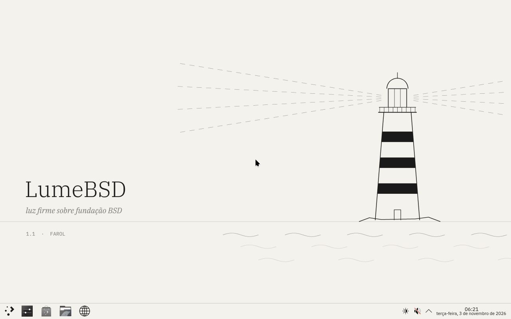
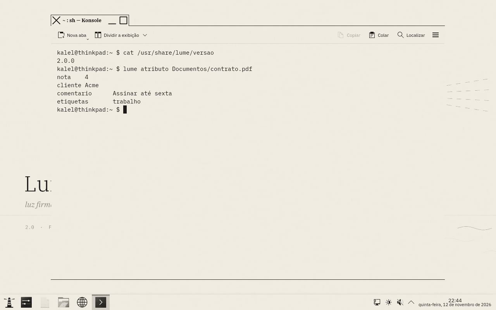
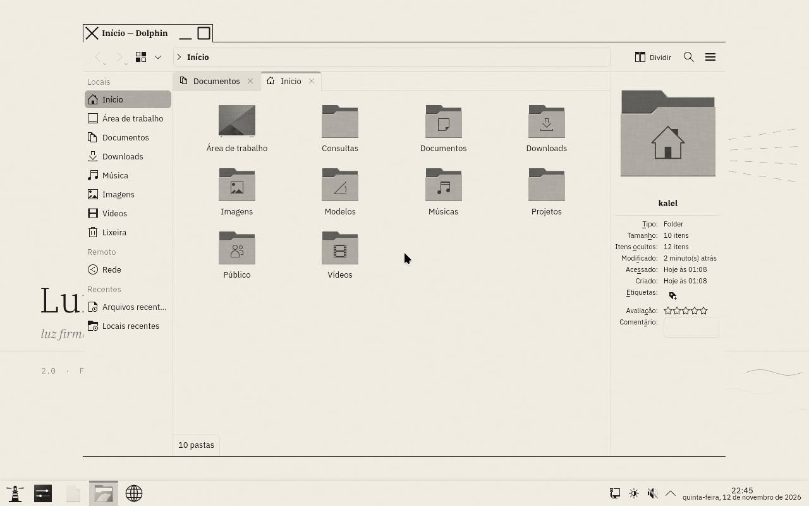
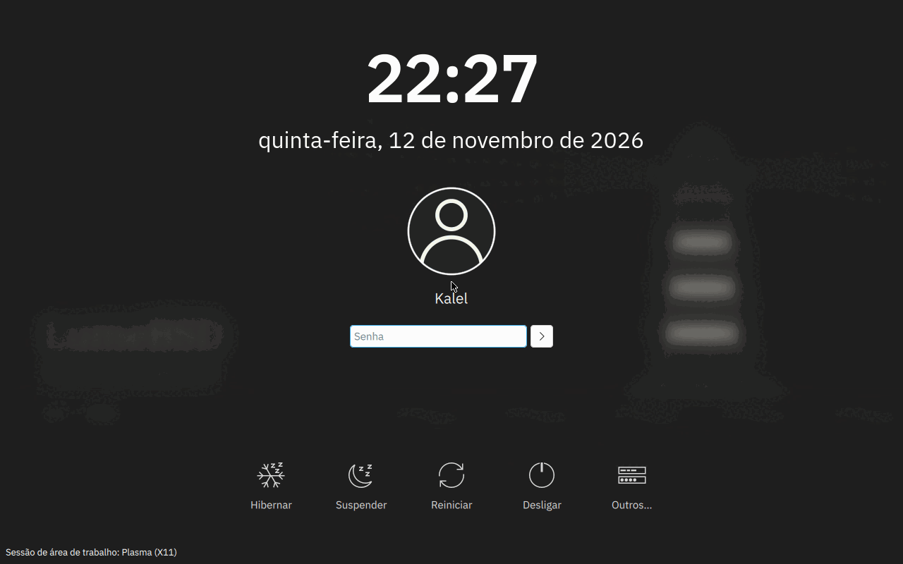

# LumeBSD 1.1.1 "Farol"

[](https://github.com/Kalel047/lumebsd/actions/workflows/verificar.yml)
[](https://github.com/Kalel047/lumebsd/actions/workflows/build.yml)
[](LICENSE)

> Luz firme sobre fundação BSD.

LumeBSD é uma distribuição BSD independente construída a partir do código-fonte
do **FreeBSD 15.1** (`releng/15.1`). Ela mantém a base sólida do FreeBSD
(kernel, userland, rc.d, ZFS, ports/pkg) e dá ao sistema identidade,
ferramentas e padrões próprios.

A ideia: **um BSD de desktop que já chega pronto para quem fala português**.
Você grava o pendrive, testa o hardware sem tocar no disco, instala com
criptografia em poucos minutos e entra num KDE Plasma com visual próprio,
em pt-BR, com teclado ABNT2 e horário de Brasília.

```
     \    |    /
   ---  (( ))  ---
     /   _|_   \
        /___\
        |[_]|        LumeBSD 1.1
        |===|        "Farol"
        |   |
        |===|
       /|   |\
        |===|
       _|___|_
  ~~~~/_______\~~~~
   ~~   ~~~~   ~~
```

## Novidades

| | |
|---|---|
| **Atualizações que não quebram** (1.1.1) | `lume atualizar` instala a versão nova num ambiente de boot à parte, testa no boot seguinte e só então a torna padrão; se algo der errado, o computador volta sozinho para o sistema anterior |
| **Pendrive ao vivo + instalador** | boota sem tocar no disco; `lume hardware` diz o que funciona; `lume instalar` instala no disco inteiro |
| **PCs Intel + NVIDIA** | o driver NVIDIA certo para a geração da placa (Turing/GTX 16xx em diante, 580 para Maxwell–Volta, 470 para Kepler), Intel em notebooks e híbridos, e volta sozinho ao modo sem aceleração se um driver travar |
| **ZFS criptografado** | GELI AES-256-XTS com senha no boot, swap criptografada, ambientes de boot (`bectl`) |
| **forja** | gerenciador de pacotes no estilo Portage: binário por padrão, compilado com as suas opções (as "USE flags") quando você muda alguma |
| **Tema Papel** | KDE Plasma com estética e-ink: papel, tinta e cinzas |
| **Base** | FreeBSD 15.1, kernel `LUME` completo (todos os módulos, DTrace), compilado com LLVM 19 |

## Do pendrive ao desktop

### 1. Gravar

Baixe `LumeBSD-1.1-Farol-pendrive.img.xz` das
[Releases](https://github.com/Kalel047/lumebsd/releases) (ou do último
[Build completo](https://github.com/Kalel047/lumebsd/actions/workflows/build.yml),
em "Artifacts"), confira o SHA256 com o `SHA256SUMS` que vem junto, extraia
(7-Zip no Windows) e grave num pendrive de 8 GB ou mais:

- **Windows**: [Rufus](https://rufus.ie), escolha a imagem e, quando ele
  perguntar, **modo DD**.
- **Linux/FreeBSD**: `dd if=LumeBSD-1.1-Farol-pendrive.img of=/dev/SEU_PENDRIVE bs=1M`

Na BIOS/UEFI do PC, desligue o *Secure Boot* (o loader do FreeBSD não é
assinado) e dê boot pelo pendrive (F12 na maioria das placas).

### 2. Testar o hardware

O pendrive é um LumeBSD completo. Entra como root, sem senha, e nada no
disco do computador é alterado.

```
root@lume-ao-vivo:~ # lume hardware        (numa VM; no seu PC aparece a sua placa)

  LumeBSD - diagnóstico de hardware
  QEMU pc-q35-8.2 (Standard PC (Q35 + ICH9, 2009))
  ------------------------------------------------------------
  ✓ processador    QEMU Virtual CPU version 2.5+ (2 núcleos)
  ! energia CPU    sem controle de frequência
  ✓ memória       4 GiB
  ✓ disco nda0     QEMU NVMe Ctrl 42 GB
  ! vídeo         sem placa NVIDIA ou Intel: modo sem aceleração
  ! Wi-Fi          nenhuma placa encontrada
  ✓ rede em0       cabo active
  ✗ som            nenhuma placa de som reconhecida
  ------------------------------------------------------------
  4 ok, 3 atenção, 1 não funciona
```

`lume video testar` carrega o driver de vídeo na hora, para você ver se
ele funciona antes de instalar. `lume wifi` conecta no Wi-Fi.

### 3. Instalar

```
root@lume-ao-vivo:~ # lume instalar
```

Ele pergunta o disco, pede para você digitar `APAGAR`, pede a senha do
disco e instala:

- GPT com partição EFI, swap de 8 GB criptografada e o resto em ZFS sobre
  GELI (AES-256-XTS); a senha é pedida pelo loader, antes do sistema;
- datasets do ZFS no esquema de ambientes de boot (`zroot/ROOT/default`),
  então `bectl` e as atualizações da forja têm volta;
- boot UEFI registrado com `efibootmgr` e no caminho padrão `BOOTX64.EFI`;
- os drivers e firmwares que vêm no pendrive;
- com internet, o desktop (KDE Plasma 6, Firefox, Konsole, Dolphin, Kate,
  Okular, PipeWire...) já com o driver de vídeo certo e o tema Papel.

> Reinstalando num PC que já tem o LumeBSD? O loader do pendrive vê o
> disco criptografado e pergunta a senha dele: aperte Enter para pular.

### 4. Primeiro boot

Depois da senha do disco, o assistente em português pergunta o essencial:

```
  [1/6] Senha do administrador (root)
  [2/6] Seu usuário              -> grupos wheel, operator e video
  [3/6] Nome desta máquina
  [4/6] Fuso horário             -> padrão America/Sao_Paulo
  [5/6] Teclado                  -> ABNT2, US internacional, US ou Portugal
  [6/6] Idioma do sistema        -> Português (Brasil) ou English (US)
```

e o sistema sobe direto na tela de login gráfica.

## Atualizações que não quebram

Como fica (exemplo de uma versão 1.1.2 futura):

```
root@farol:~ # lume atualizar
  ✓ versão nova: 1.1.2 (você tem a 1.1.1)

  Instalar agora? O sistema atual fica guardado. [S/n]:
  ✓ pacote conferido (SHA256)
  Instalando o LumeBSD 1.1.2 no ambiente de boot lume-1.1.2
  (o sistema em uso, lume-1.1.1, não é tocado)
  ✓ LumeBSD 1.1.2 instalado em lume-1.1.2

  Reinicie para entrar nele (shutdown -r now).
  Se o boot falhar, o computador volta sozinho para o lume-1.1.1.
  Se der tudo certo, a atualização é confirmada no fim do boot.
```

No FreeBSD, o `freebsd-update` troca os arquivos do sistema em uso; se a
atualização der errado no meio, ou o sistema novo não subir, quem conserta
é você. No LumeBSD:

1. a versão nova vai para um **ambiente de boot novo** (uma cópia do
   sistema no ZFS); o sistema em uso não é tocado;
2. ele é ativado **só para o próximo boot** (`bectl activate -t`);
3. no fim desse boot, o `rc.d/lume_saude` confere o sistema: a raiz veio
   do ambiente certo, os programas básicos existem, o vigia responde, a
   tela de login subiu. Passou: a atualização vira o **padrão**;
4. não passou, o kernel entrou em pânico ou o computador travou: o boot
   seguinte volta **sozinho** para o sistema anterior, intacto. O motivo
   fica em `/var/log/lume-atualizar.log`.

Suas configurações ficam como estão; quando a versão nova traz uma
diferente, ela aparece ao lado, com o final `.lume-novo`. Usuários e senhas
nunca são tocados. Outros comandos: `lume atualizar estado`, `voltar`
(o sistema de antes vira o padrão de novo), `confirmar` e `limpar`.

As versões saem nas [Releases](https://github.com/Kalel047/lumebsd/releases):
o índice `atualizacao.txt` diz a versão e o SHA256 do pacote do sistema.

> Quem instalou a 1.1.0 (o primeiro pendrive) ainda não tem o comando; ele
> vem na própria atualização:
> `fetch -o /tmp/lume-atualizar https://raw.githubusercontent.com/Kalel047/lumebsd/main/fonte/usr.sbin/lume-configurar/lume-atualizar.sh && sh /tmp/lume-atualizar aplicar`

## Vídeo: Intel + NVIDIA

`lume video` decide a cada boot (`rc.d/lume_video`):

| Computador | Driver |
|---|---|
| Desktop com NVIDIA Turing em diante (GTX 16xx, RTX) | `nvidia-driver` (595) |
| NVIDIA Maxwell, Pascal ou Volta (GTX 9xx/10xx) | `nvidia-driver-580` |
| NVIDIA Kepler (GTX 6xx/7xx) | `nvidia-driver-470` |
| Intel (inclusive notebook híbrido Intel + NVIDIA) | `drm-612-kmod` (i915/xe) |
| Nada disso, ou um driver que falhou | `scfb` (framebuffer UEFI, sem aceleração) |

Se o driver travar o computador no boot, o boot seguinte percebe (marca em
`/var/db/lume/video-tentando`) e passa para o `scfb` sozinho. Dá para fixar
um modo: `lume video nvidia | intel | scfb | auto`.

> Num notebook híbrido, a tela interna está ligada na Intel; a NVIDIA
> fica sem uso (o FreeBSD não tem PRIME offload maduro).

## forja: pacotes no estilo Portage

```
forja instalar htop                 # binário oficial, instala em segundos
forja opcoes nano -NLS -DOCS        # muda opções (as "USE flags")
forja instalar nano                 # agora compila da árvore de ports com elas
forja atualizar                     # snapshot do ZFS, binários e recompilações
forja mundo                         # o que você pediu (o @world)
```

- Cada pacote vem **binário** até você mudar uma opção dele; aí a forja o
  compila da árvore de ports com as suas opções e o **trava** (`pkg lock`)
  para a atualização binária não desfazer a escolha.
- `forja atualizar` cria um ambiente de boot antes de mexer em qualquer
  coisa (`bectl`), atualiza os binários e recompila só o que mudou de
  versão ou de opções.
- `forja arvore` baixa a árvore de ports do trimestre (`2026Q4`).
- Arquivos: `/etc/forja/forja.conf`, `/etc/forja/opcoes`,
  `/var/db/forja/mundo`. Manual: `man forja`.

## Tema Papel (e-ink)

O desktop vem com um visual próprio inspirado nas telas de e-ink
(Kindle, reMarkable, Boox) e nos setups monocromáticos do r/unixporn:

- **cores**: papel `#F4F2EC`, tinta `#1A1A1A` e cinzas quentes; o único
  acento é um vermelho escuro para erros; seleção invertida (tinta sobre
  papel, como num e-reader);
- **fontes**: IBM Plex Sans, Serif (títulos das janelas) e Mono (terminal);
- **sem animações, sombras nem transparência** (`AnimationDurationFactor=0`,
  composição desligada): a tela muda de uma vez, como e-ink, e o desktop
  fica leve até no modo sem aceleração;
- **ícones em tons de cinza**: o tema `lume-papel` é gerado a partir do
  Breeze, convertendo cada cor para luminância;
- **papel de parede**: o farol em traço sobre papel (`papel.png`) e uma
  versão noturna (`papel-noite.png`), em 4K;
- Konsole, SDDM (tela de login), tela de bloqueio, GTK e splash seguem o
  mesmo tema.

`lume tema padrao` volta ao visual original do KDE; `lume tema papel`
aplica de novo.

| | |
|---|---|
|  |  |
|  |  |

<sub>Capturas reais do sistema instalado numa VM (sem aceleração de vídeo).</sub>

## Ferramentas do LumeBSD

| Comando | O que faz |
|---|---|
| `lume` | painel: kernel, CPU, memória, disco, carga, serviços |
| `lume hardware` | o que funciona neste computador |
| `lume video [testar\|auto\|nvidia\|intel\|scfb]` | driver de vídeo |
| `lume wifi` | conecta no Wi-Fi |
| `lume desktop` | instala o KDE Plasma e os drivers |
| `lume instalar` | instala no disco inteiro (ZFS + GELI) |
| `lume atualizar` | atualiza o sistema num ambiente de boot, com volta automática |
| `lume tema [papel\|padrao]` | visual do KDE |
| `lume configurar` | assistente de configuração |
| `vigia` | gerenciador de serviços (abaixo) |
| `forja` | pacotes por binário ou código-fonte |

### vigia: serviços que se reerguem sozinhos

Cada serviço é um arquivo de poucas linhas em `/etc/vigia/servicos`:

```ini
descricao = Página "Olá" na porta 8080
comando   = sh -c 'while true; do printf "HTTP/1.0 200 OK\r\n\r\nOlá\n" | nc -N -l 8080; done'
usuario   = nobody
depende   = relogio
reiniciar = sempre
limite_memoria = 64M
limite_cpu     = 50%
```

O `vigiad` sobe os serviços na ordem das dependências, reinicia o que cair
(1, 2, 4… até 30 s), põe em **manutenção** depois de 5 quedas seguidas,
guarda a saída em `/var/log/vigia/`, limita memória, CPU e processos pelo
RCTL do kernel, atende sockets sob demanda (`escutar = tcp:7777`, como o
`inetd`) e para em cascata quem depende de um serviço parado.

```
root@lumebox:~ # vigia
  SERVIÇO       ESTADO         PID     HÁ         REINÍCIOS  DESCRIÇÃO
  instavel      ● manutenção   -       11 s       4          Serviço instável (demonstração)
    └ saiu com código 3; caiu 5 vezes seguidas, veja 'vigia log instavel' e use 'vigia reiniciar instavel'
  ntpd          ● ativo        1114    53 s       0          Relógio sincronizado pela internet (NTP)
  web           ● ativo        1224    39 s       1          Página "Olá" na porta 8080
```

Manuais: `man vigia` e `man vigia.conf`. Sessões reais em
[docs/vigia-sessao.log](docs/vigia-sessao.log) e
[docs/vigia-recursos-sessao.log](docs/vigia-recursos-sessao.log).

## Estrutura

```
patches/               a fonte de verdade: o que muda no FreeBSD, em ordem
  0001..0004           identidade, assistente, vigia (da 1.0)
  0005                 base FreeBSD 15.1, kernel LUME completo
  0006                 pendrive: lume hardware, video, wifi, desktop, instalar
  0007..0009           pkg trimestral, espelho local, kernel com CTF
  0010                 vídeo Intel + NVIDIA por geração
  0011                 forja
  0012                 tema Papel
  0013..               correções que os testes pegaram
fonte/                 os mesmos arquivos em texto puro, para ler e navegar
                       (forja, lume, vigia, lume-configurar, rc.d, tema...)
conf/                  src.conf (userland) e LUME (kernel)
build-lumebsd.sh       do FreeBSD fixado até a imagem do pendrive
ferramentas/           pacotes.py, montar-pendrive.py, fonte.py,
                       papel-de-parede.py
tests/                 testes no QEMU pelo console serial
docs/ARQUITETURA.md    como tudo funciona por dentro
docs/                  sessões reais e capturas de tela
.github/               CI (Verificar e Build completo) e modelos de issue
```

Para mudar o código: edite a árvore do FreeBSD com os patches aplicados,
faça commit, gere os patches de novo
(`git format-patch -N --no-signature <commit fixado>..HEAD -o patches/`) e rode
`python3 ferramentas/fonte.py gerar src`. O CI recusa `fonte/` diferente dos
patches.

## Construindo

Funciona em Linux (cross-build com LLVM 19) ou FreeBSD:

```sh
git clone https://github.com/Kalel047/lumebsd.git
cd lumebsd
sh build-lumebsd.sh
```

O script clona o FreeBSD `releng/15.1`, aplica os patches, compila
userland e kernel `LUME`, instala num diretório de staging sem precisar de
root, baixa os pacotes essenciais do repositório trimestral do FreeBSD
(conferindo os hashes) e gera `LumeBSD-1.1-Farol-pendrive.img`.
Leva várias horas numa máquina de 2 núcleos (o world é a parte longa).

Dependências no Ubuntu/Debian:

```sh
sudo apt install clang-19 lld-19 llvm-19 libarchive-dev libbz2-dev zlib1g-dev \
    bison flex time python3 qemu-system-x86 ovmf
```

> Precisa ser o **LLVM 19** (o mesmo do FreeBSD 15.1). O clang 18 do
> Ubuntu acessa `__stack_chk_guard` pela GOT nos módulos do kernel, e o
> linker do kernel recusa essa relocação: metade dos módulos (inclusive
> `zfs.ko` e `geom_eli.ko`) não carregaria.

## Testando

O teste automatizado faz o caminho de um usuário no QEMU (UEFI, disco
NVMe de destino), conversando pelo console serial:

```sh
python3 -m http.server 8000 -d ESPELHO &   # espelho dos pacotes (opcional)
python3 tests/teste-pendrive.py aovivo    aovivo.log     # boot, lume hardware, instala
python3 tests/teste-pendrive.py instalado instalado.log  # senha do disco, assistente
python3 tests/teste-pendrive.py desktop   desktop.log    # login gráfico, fotos da tela
python3 tests/teste-pendrive.py forja     forja.log      # binário, compilação, atualizar
```

## Status

Tudo abaixo foi testado de ponta a ponta no QEMU (UEFI/OVMF, sem KVM),
com um disco NVMe de 40 GB como destino e o pendrive ligado em SATA:

- [x] **Build do zero**: FreeBSD 15.1 + 24 patches, world com LLVM, kernel
  `LUME` completo (847 módulos) com LLVM 19 — também no GitHub Actions
  (2h12 de build, imagem bootada no QEMU), a partir deste repositório
- [x] **Pendrive ao vivo**: boot até o login em ~1 min (emulado), `lume
  hardware`, `lume video`, drivers do pendrive carregando
- [x] **Instalação**: GPT + EFI + swap GELI + ZFS sobre GELI AES-256-XTS,
  ambientes de boot, entrada UEFI "LumeBSD"; desktop KDE (692 pacotes)
  instalado a partir de um espelho, tema Papel aplicado, 7 847 ícones
  convertidos — ~49 min emulado
- [x] **Primeiro boot**: senha do disco pedida uma vez pelo loader,
  assistente completo (root, usuário nos grupos wheel/operator/video,
  máquina, fuso, ABNT2, pt-BR), SDDM no ar
- [x] **Desktop**: login gráfico em português, Plasma 6.7 com o tema Papel,
  Konsole e Dolphin abertos na sessão (capturas em `docs/capturas/`)
- [x] **forja**: binário (`htop`), opções `-NLS -DOCS`, compilação do
  `nano` da árvore de ports com as dependências diretas em binário
  (`nano --version` → `--disable-nls`), `forja mundo`/`info`, `forja
  atualizar` com ambiente de boot antes e recompilação ao mudar opção
- [x] **Atualização**: 1.1.0 → 1.1.1 num sistema instalado pela 1.1.0,
  confirmada sozinha no boot; uma 1.1.2 com o `vigiad` quebrado (checagem
  reprovada, motivo no log, reboot de volta à 1.1.1); uma 1.1.2 com o
  `init` quebrado (pânico, reboot automático, de volta à 1.1.1); boot
  interrompido no meio (de volta ao anterior)
- [x] **Ambientes de boot**: numa instalação nova, bootar outro ambiente
  roda de fato aquele ambiente
- Sessões completas: [instalação pelo pendrive](docs/pendrive-instalacao.log),
  [primeiro boot](docs/primeiro-boot-instalado.log), [forja](docs/forja-sessao.log),
  [atualizações e volta automática](docs/atualizacao-sessao.log)
- [ ] **Hardware real**: não testado aqui. Em especial o driver NVIDIA
  (precisa da placa) — no pendrive, rode `lume hardware` e
  `lume video testar` antes de instalar

### Bugs que os testes pegaram (e já estão corrigidos)

| Bug | Correção |
|---|---|
| Metade dos módulos do kernel (inclusive `zfs.ko` e `geom_eli.ko`) não carregava | compilar com LLVM 19: o clang 18 acessa `__stack_chk_guard` pela GOT |
| Compilador mirava `freebsd1.1` (a versão do LumeBSD) | `FREEBSD_REVISION` no `newvers.sh` |
| Senha do disco pedida duas vezes | sem `geom_eli_passphrase_prompt` (o loader já repassa a chave) |
| Assistente pulava em 120 s mesmo com desktop, deixando o sistema sem usuário | com o SDDM ligado ele espera |
| Teclado ABNT2 e português só no console | `00-lume-teclado.conf` para o Xorg e `sddm_lang` |
| Sistema instalado mostrava a mensagem do pendrive ("root sem senha") | `motd` original preservado no build |
| Baloo (indexador do KDE) caindo em loop; arquivos `.core` na pasta do usuário | Baloo desligado por padrão; cores em `/var/crash` |
| Ports recusavam compilar (`uname` diz LumeBSD 1.1) | a forja e o `/etc/make.conf` passam FreeBSD 15.1 aos ports |
| forja passava a origem como alvo do make; dependências de dependências em fonte | corrigido; dependências diretas em binário |
| Bootar outro ambiente de boot (inclusive os da forja) montava o antigo por cima | `ROOT/default` com `canmount=noauto` e sem `vfs.root.mountfrom` fixo no `loader.conf`; o `lume atualizar` conserta instalações antigas |
| Atualização trocaria `pwd.db`/`spwd.db` (usuários e senhas) pelos do build | bancos derivados nunca vêm do pacote |
| `rc.d` tem a tag `config` no METALOG e não seria atualizado | `rc.d`, `periodic` e `defaults` são do sistema |

### Compilando programas à mão

O `uname` do LumeBSD diz `LumeBSD 1.1-FAROL`. Pela forja ou por
`/usr/ports` isso é resolvido sozinho. Para um `./configure` fora dos
ports que não reconheça o sistema:

```sh
env UNAME_s=FreeBSD UNAME_r=15.1-RELEASE ./configure
```

## Bugs e hardware

Abra uma [issue](https://github.com/Kalel047/lumebsd/issues/new/choose):
há modelos para bugs e para relatar em que computador o LumeBSD rodou
(com a saída de `lume hardware`).

## Licença

Tudo o que está neste repositório é distribuído sob a licença BSD de 2
cláusulas (veja `LICENSE`): os patches, a forja, o `lume`, o vigia, os
scripts, o tema Papel, os papéis de parede e o emblema do farol.

A imagem do pendrive junta isso ao FreeBSD (licenças BSD e outras, veja
`/usr/share/doc/legal` no sistema) e a pacotes de terceiros com as próprias
licenças, como o KDE, o Firefox e o driver da NVIDIA (proprietário,
redistribuído como no repositório oficial do FreeBSD).
"FreeBSD" é marca registrada da FreeBSD Foundation; o LumeBSD é um projeto
independente, sem afiliação com o FreeBSD Project. NVIDIA, Intel e KDE são
marcas de seus donos.
